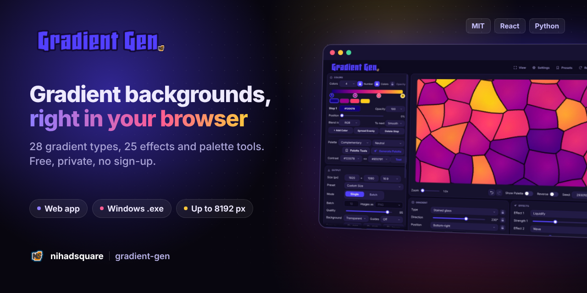
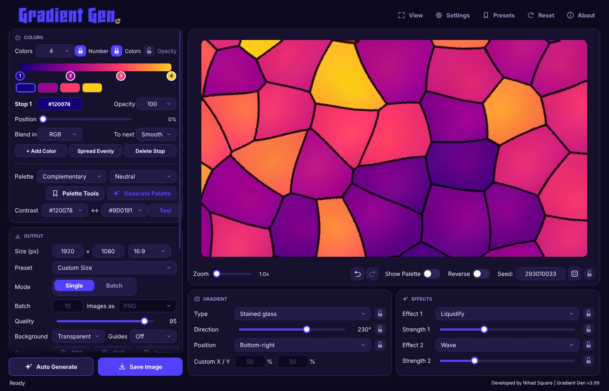

# Gradient Gen


[](https://github.com/NihadSquare/gradient-gen/actions/workflows/deploy.yml)
[](LICENSE)

**Make backgrounds and wallpapers in your browser.** 28 gradient types, 25 effects, multi-stop colors with RGB / HSL / OKLab blending, palette tools, overlays and exports up to 4096 px.

### 👉 [Open Gradient Gen](https://nihadsquare.github.io/gradient-gen/)   ·   ⬇ [Download for Windows](#windows-app-desktop-version-41)



It is a static site: every picture is drawn on your device, nothing is uploaded, there is no sign-up and no server to run or pay for. It is the web version of the desktop app *Gradient Gen* (the Windows version is available too, see below): the same interface, the same windows, and the same seed gives the same picture in both.

## Features

- **Colors**: up to 12 stops on a draggable bar, per-stop opacity, four transition styles (Smooth, Ease, Step, Hold), reverse
- **28 gradient types**: Linear, Radial, Conical, Diamond, Spiral, Swirl, Plasma, Voronoi, Cylindrical, Pixelated, Abstract, Parametric, Perlin, Wave, Starburst, Kaleidoscope, Tiled, Hexagonal, Bilinear, Fractal, Mesh, Aurora, Marble, Contour, Halftone, Dither, Silk, Stained glass
- **25 effects**, two at a time: noise, grain, blur, glow, glitch, pixel sort, light leak, gradient map and more
- **Palette tools**: 28 built-in palettes, harmony generator (11 schemes), colors from an image (7 pick modes), paste hex / Coolors / GIMP, save your own, copy as HEX / JSON / CSS
- **Color contrast checker** with WCAG levels and one-click fixes
- **Overlays**: text and logo, plus White / Black / Transparent background
- **Output**: PNG, JPEG, WebP; 13 size presets; batch mode that saves a ZIP; guides (thirds, golden ratio, safe area, social crops)
- **Copy as CSS / SVG / image**
- **Auto Generate** with per-setting locks, **undo/redo**, **presets** (import/export JSON), 8 themes, keyboard shortcuts
- Works on phones and tablets, and offline once loaded

## Windows app (desktop version 4.1)

### ⬇ [Download GradientGen-4.1-win64.exe](https://github.com/nihadsquare/gradient-gen/releases/download/windows-v4.1/GradientGen-4.1-win64.exe)

[Release page with notes and checksum](https://github.com/nihadsquare/gradient-gen/releases/tag/windows-v4.1) · [All releases](https://github.com/nihadsquare/gradient-gen/releases)

The original desktop program as one portable file. No installer, no admin rights, works offline.

| | |
| --- | --- |
| **Version** | 4.1 |
| **Works on** | Windows 10 and 11, 64-bit |
| **Install** | None. Save the file anywhere (Desktop, USB stick) and double-click it |
| **Internet** | Not needed |
| **Largest picture** | 8192 × 8192 px |
| **Your data** | Presets, palettes and preferences are saved in `%APPDATA%\GradientGen`, so you can move or replace the `.exe` without losing them |
| **Licence** | MIT |

**What you get:** everything in the web app (28 gradient types, 25 effects, palette tools, contrast checker, overlays, presets), plus exports up to 8192 px, batch export straight into a folder, a default save folder, and remembered window size.

### The first start

The file is not signed with a paid certificate, so Windows SmartScreen shows a blue "Windows protected your PC" box the first time.
1. Click **More info**.
2. Click **Run anyway**.

The first start takes a few seconds longer because the single file unpacks itself. Some antivirus programs warn about any new program made with PyInstaller. Check your download against the `.sha256` file on the release page:

```powershell
Get-FileHash .\GradientGen-4.1-win64.exe -Algorithm SHA256
```

To remove the program, delete the `.exe`. To erase its saved data too, delete the folder `%APPDATA%\GradientGen`.

### Web or Windows?

| | Web app | Windows app |
| --- | --- | --- |
| Install | None | None (one file) |
| Largest picture | 4096 × 4096 px | 8192 × 8192 px |
| Undo / redo | Every edit (up to 80) | Last 5 Auto Generate pictures |
| Batch export | One ZIP | Files in a folder |
| Offline | After the first visit | Always |
| Updates | Automatic | Download the new file |

Build it yourself, or read how it is made: [desktop/README.md](desktop/README.md).

## Run it locally

Requires Node.js 18 or newer.

```bash
npm install
npm run dev        # http://localhost:5173
npm test           # unit tests
npm run build      # production build in dist/
npm run preview    # serve dist/ locally
```

## Deploy your own copy

1. Fork this repository (or push the code to a new one).
2. *Settings* → *Pages* → *Build and deployment* → *Source:* **GitHub Actions**.
3. Push to `main`. The workflow in `.github/workflows/deploy.yml` runs the checks and publishes the site at `https://YOUR-USERNAME.github.io/REPOSITORY-NAME/`.

The build uses relative paths (`base: "./"`), so it works at any address, including a custom domain. Change `REPO_URL` and `SITE_URL` in `src/config.ts` and the address in `index.html` to point to your copy.

## How it works

| Folder | What is in it |
| --- | --- |
| `src/engine/` | The renderer. No DOM, so it runs in a Web Worker and in Node tests. `fields.ts` (gradient types), `effects.ts`, `color.ts` (OKLab / HSL / ramp table), `palette.ts`, `code.ts` (CSS / SVG), `random.ts` (Auto Generate) |
| `src/lib/` | Browser glue: worker client, canvas overlays, file saving, ZIP writer, themes, storage |
| `src/store/` | App state (zustand), history, presets, saved palettes |
| `src/components/` | React interface |
| `tests/` | Vitest unit tests |

Previews are drawn by a Web Worker so the page stays responsive. If workers are unavailable, the app falls back to the main thread.

See [docs/PORTING_NOTES.md](docs/PORTING_NOTES.md) for what changed compared with the desktop version and how the port was checked.

## Limits

- Largest picture: **4096 × 4096 px** (browsers limit canvas and memory, especially on phones).
- Batch size depends on the picture size so the ZIP fits in memory (up to 100).
- Everything is stored in your browser (`localStorage`). Clearing site data removes presets and saved palettes; use *Presets → Export all* to keep a backup.

## Contributing

Bug reports and ideas are welcome. Please read [CONTRIBUTING.md](CONTRIBUTING.md) first. Security issues: see [SECURITY.md](SECURITY.md).

## Credits and licence

Developed by **AK Nihad** ([@NihadSquare](https://github.com/NihadSquare)) under the **Nihad Square** brand.
Released under the [MIT licence](LICENSE). Third-party software and fonts are listed in [THIRD_PARTY_NOTICES.md](THIRD_PARTY_NOTICES.md).
